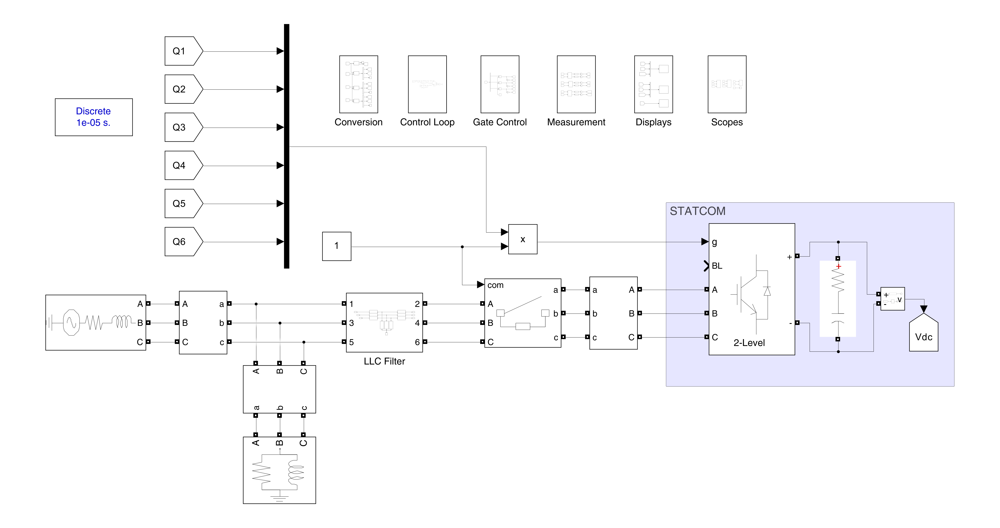
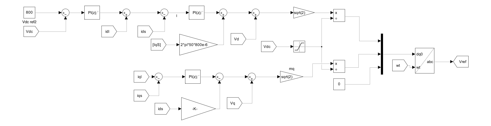
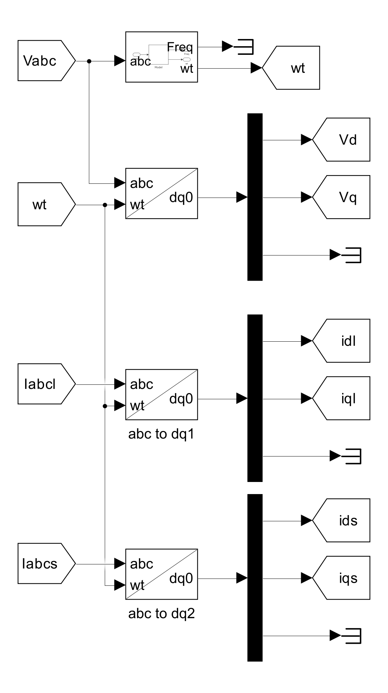
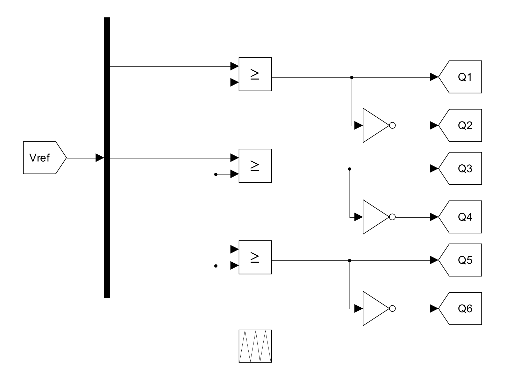
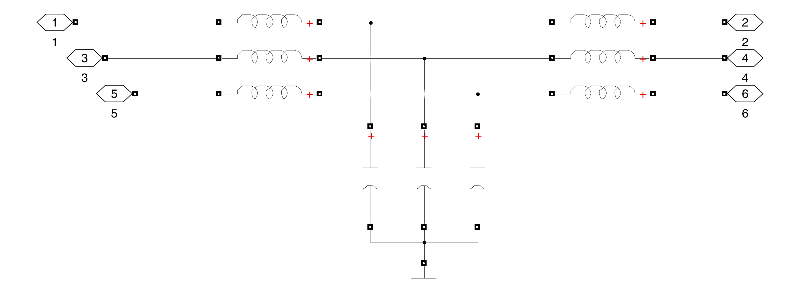
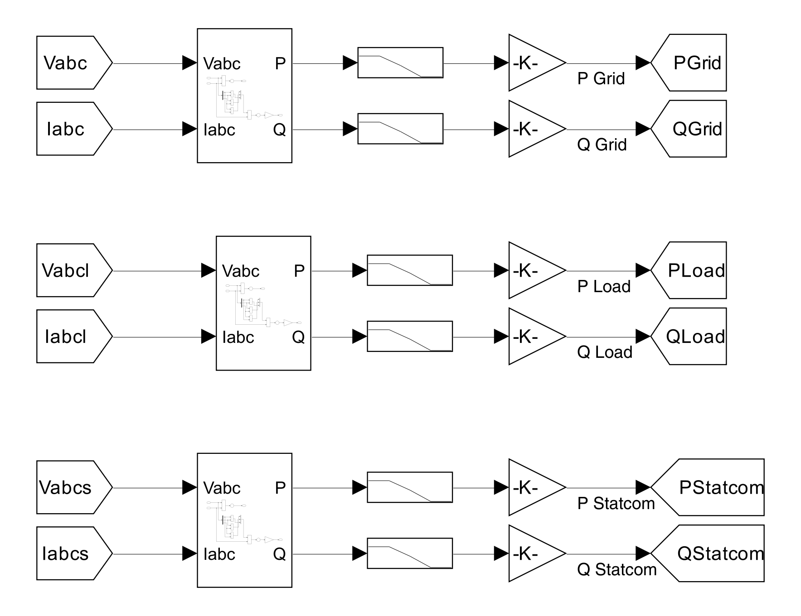
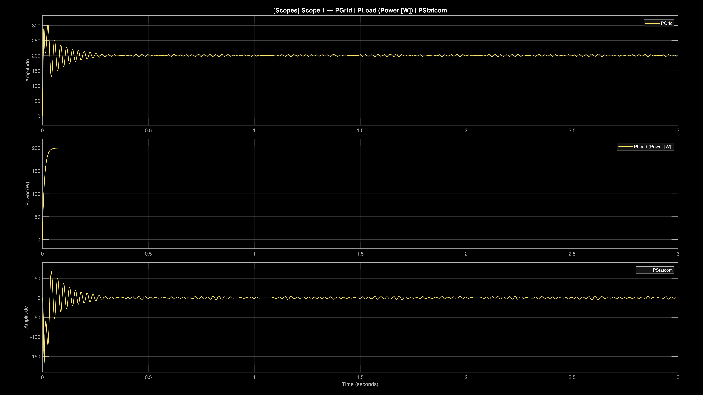
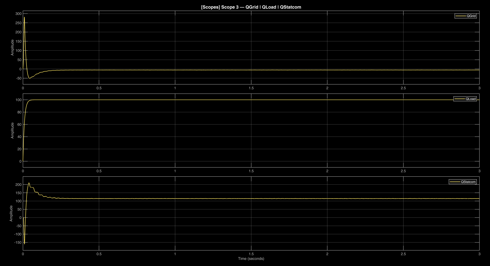
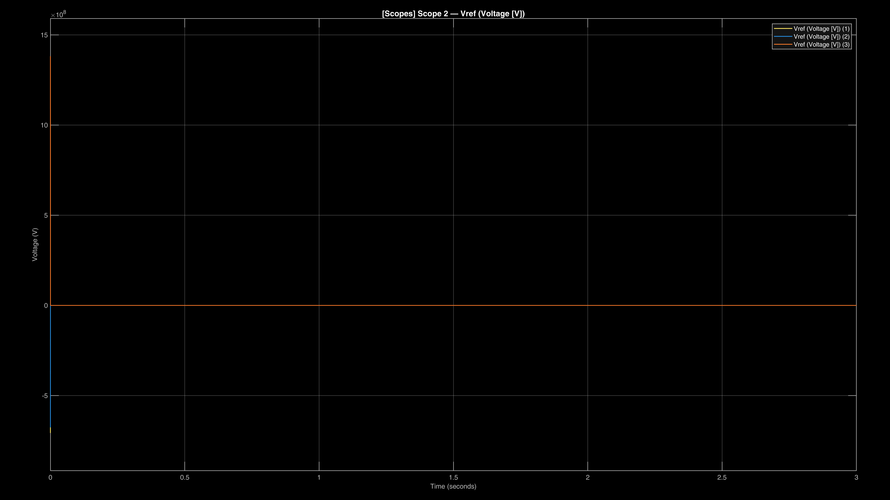
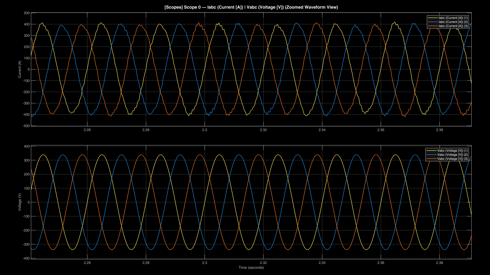

# Grid-Connected STATCOM: dq0 Control, Reactive Power Compensation & Voltage Regulation

<p align="center">
  
  
  
  
  
</p>

> **Project Engineer:** Abd El-Rhman Muhammad Saad  
> **Academic Institution:** Faculty of Engineering, Alexandria University (Class of 2026)  
> **Department:** Electrical Engineering Department  
> **Course / Specialization:** Power System Compensation / FACTS & Power Quality  
> **Core Focus:** Grid-Connected STATCOM, Synchronous Reference Frame ($dq0$) Decoupled Control, Dynamic Reactive Power Compensation & LCL Filtering  
> **Academic Documentation:** [Full Project Technical Report (PDF)](Docs/statcom-dq0-control.pdf) | [Simulink Model Source](Simulation/STATCOM.slx)

---

## 1. Executive Summary & Engineering Architecture

This repository delivers the analytical design, mathematical modeling, control synthesis, and high-fidelity MATLAB/Simulink simulation of a grid-connected **Static Synchronous Compensator (STATCOM)** based on a **Two-Level Voltage Source Converter (VSC)**. Developed as an advanced power quality and FACTS (Flexible AC Transmission Systems) solution, the STATCOM provides high-speed dynamic reactive power compensation for localized, highly inductive industrial loads, restoring the utility grid power factor strictly to **unity ($PF = 1.000$)**.

The local load draws $200.0\text{ kW}$ of active power and $100.0\text{ kVAR}$ of inductive reactive power from a three-phase $415.0\text{ V}$ (line-to-line RMS), $50.0\text{ Hz}$ distribution grid, causing transmission line voltage drops and an uncompensated power factor of $0.894$ lagging. The STATCOM acts as a controllable shunt-connected AC voltage source that synthesizes a pure capacitive reactive power output of $-100.0\text{ kVAR}$ at the Point of Common Coupling (PCC), relieving the utility grid of inductive current burdens.

<p align="center">
  
</p>

### Key Subsystem Layers
1. **Three-Phase Utility Interconnection:** A stiff $415\text{ V}$ three-phase source coupled through line impedance to the PCC.
2. **Industrial Load Branch:** A three-phase parallel RLC branch absorbing $200\text{ kW}$ active and $100\text{ kVAR}$ inductive power.
3. **Two-Level Voltage Source Converter (VSC):** Six IGBT/Diode switches arranged in a three-phase bridge topology energized by a $10.0\text{ mF}$ DC-link capacitor regulated at $800.0\text{ V DC}$.
4. **Cascaded $dq0$ Control Hierarchy:** Voltage-Oriented Control (VOC) separating the active power channel (DC voltage regulation) from the reactive power channel ($Q$ compensation).
5. **High-Frequency SPWM Modulation:** Sinusoidal Pulse-Width Modulation operating at a $10.0\text{ kHz}$ carrier frequency with natural anti-windup clamping.
6. **Harmonic Interfacing Filter:** Third-order passive $LCL$ filter ($L_1 = 300\ \mu\text{H}, L_2 = 500\ \mu\text{H}, C_f = 100\ \mu\text{F}$) trapping switching harmonics and ensuring clean grid sinusoidal currents.

---

## 2. Master System Specifications

The physical and electrical design parameters of the grid-connected STATCOM system are summarized below:

| Engineering Parameter | Symbol | Benchmark Value | Physical / Operational Significance |
| :--- | :---: | :---: | :--- |
| **AC Grid Nominal Voltage** | $V_{\text{LL}}$ | **$415.0\text{ V}$ (RMS)** | Three-phase line-to-line distribution baseline |
| **Grid Operating Frequency** | $f_{\text{grid}}$ | **$50.0\text{ Hz}$** | Synchronous utility base frequency |
| **Angular Velocity Baseline** | $\omega$ | **$100\pi\text{ rad/s}$** | Synchronous grid angular velocity ($\approx 314.159\text{ rad/s}$) |
| **Load Active Power** | $P_L$ | **$200.0\text{ kW}$** | Real power absorbed by industrial facility |
| **Load Reactive Power** | $Q_L$ | **$+100.0\text{ kVAR}$** | Inductive reactive power demand to be compensated |
| **Uncompensated Power Factor** | $PF_{\text{initial}}$ | **$0.894$ Lagging** | Baseline uncompensated load power factor |
| **Target Grid Power Factor** | $PF_{\text{target}}$ | **$1.000$ (Unity)** | Post-compensation objective ($Q_{\text{grid}} \to 0$) |
| **DC-Link Target Voltage** | $V_{\text{dc}}^*$ | **$800.0\text{ V DC}$** | Regulated capacitor potential ($> \sqrt{2} \cdot V_{\text{LL}}$) |
| **DC-Link Bus Capacitance** | $C_{\text{dc}}$ | **$10.0\text{ mF}$** | Energy storage buffer damping low-frequency DC ripple |
| **Converter-Side Inductor** | $L_1$ | **$300.0\ \mu\text{H}$** | Limits high-frequency bridge switching ripple |
| **Grid-Side Filter Inductor** | $L_2$ | **$500.0\ \mu\text{H}$** | Provides high impedance against switching injection |
| **Filter Shunt Capacitance** | $C_f$ | **$100.0\ \mu\text{F}$** | Shunts $10\text{ kHz}$ switching harmonics to neutral |
| **PWM Carrier Frequency** | $f_{\text{sw}}$ | **$10.0\text{ kHz}$** | SPWM switching carrier frequency |
| **Outer Voltage Loop PI Gains**| $K_{p,v}, K_{i,v}$ | **$5.0,\ 300.0$** | DC-link voltage error regulator gains |
| **Inner Current Loop PI Gains** | $K_{p,i}, K_{i,i}$ | **$25.0,\ 500.0$** | Fast decoupled current tracking gains |
| **Simulation Discrete Step Size**| $T_s$ | **$10.0\ \mu\text{s}$** | Discrete-solver fixed execution sample time |

---

## 3. Control Physics & Mathematical Formulations

```
   Three-Phase Grid Voltages & Currents
                  │
                  ▼
   ┌───────────────────────────────┐
   │    Three-Phase PLL System     │ ───► Grid Angle (θ = ωt)
   └───────────────────────────────┘
                  │
                  ▼
   ┌───────────────────────────────┐
   │   Park's Transform (abc->dq)  │ ───► vd, vq, id, iq
   └───────────────────────────────┘
                  │
       ┌──────────┴──────────┐
       ▼                     ▼
┌──────────────┐      ┌──────────────┐
│  Outer Loop  │      │  Inner Loop  │
│  (DC Voltage)│      │  (Reactive Q)│
└──────────────┘      └──────────────┘
  Vdc* - Vdc            Q* - Q
       │                     │
       ▼                     ▼
  PI Controller         PI Controller
       │                     │
       ▼                     ▼
   id* (Losses)          iq* (-100 kVAR)
       │                     │
       └──────────┬──────────┘
                  ▼
┌────────────────────────────────────┐
│ Inner Decoupled Current Regulators │
│  vd* = -(PI)(id* - id) + ωL iq + vd│
│  vq* = -(PI)(iq* - iq) - ωL id + vq│
└────────────────────────────────────┘
                  │
                  ▼
┌────────────────────────────────────┐
│ Inverse Park Transform (dq->abc)   │ ───► Modulating Signals (Vref)
└────────────────────────────────────┘
                  │
                  ▼
┌────────────────────────────────────┐
│  10 kHz SPWM Comparator Gate Logic │ ───► Gate Pulses (Q1 - Q6)
└────────────────────────────────────┘
```

### 3.1 Synchronous Reference Frame ($dq0$) Transformation
The three-phase AC voltages and currents are transformed into a rotating reference frame synchronous with the grid fundamental frequency via Park's Transformation:

$$\begin{bmatrix} x_d \\ x_q \\ x_0 \end{bmatrix} = \frac{2}{3} \begin{bmatrix} \cos(\theta) & \cos\left(\theta - \frac{2\pi}{3}\right) & \cos\left(\theta + \frac{2\pi}{3}\right) \\ -\sin(\theta) & -\sin\left(\theta - \frac{2\pi}{3}\right) & -\sin\left(\theta + \frac{2\pi}{3}\right) \\ \frac{1}{2} & \frac{1}{2} & \frac{1}{2} \end{bmatrix} \begin{bmatrix} x_a \\ x_b \\ x_c \end{bmatrix}$$

Under Voltage-Oriented Control (VOC) synchronized by the Phase-Locked Loop (PLL), the $d$-axis is aligned with the grid voltage vector, enforcing:

$$v_d = V_m \quad \text{and} \quad v_q = 0$$

### 3.2 Decoupled Active & Reactive Power Equations
In the synchronous frame, instantaneous active ($P$) and reactive ($Q$) powers injected by the converter are expressed as:

$$P = \frac{3}{2}(v_d i_d + v_q i_q) \xrightarrow{v_q = 0} P = \frac{3}{2} V_m i_d$$

$$Q = \frac{3}{2}(v_q i_d - v_d i_q) \xrightarrow{v_q = 0} Q = -\frac{3}{2} V_m i_q$$

This formulation proves complete **decoupling**:
* The $d$-axis current component ($i_d$) controls real power flow, exclusively dictating the charging and voltage maintenance of the DC-link capacitor.
* The $q$-axis current component ($i_q$) controls reactive power flow, directly dictating whether the STATCOM operates in inductive mode ($i_q > 0$) or capacitive compensation mode ($i_q < 0$).

### 3.3 Dynamic State Equations & Cross-Coupling Decoupling
The differential equations governing the AC-side currents through the interfacing inductance $L$ and internal resistance $R$ are:

$$L \frac{d i_d}{dt} = v_d - v_{d,\text{conv}} - R i_d + \omega L i_q$$

$$L \frac{d i_q}{dt} = v_q - v_{q,\text{conv}} - R i_q - \omega L i_d$$

The rotational cross-coupling terms ($\pm \omega L i$) cause mutual interference between channels. To achieve independent SISO control, feedforward decoupling is incorporated into the inner PI controller outputs:

$$v_d^* = - \left(K_{p,i} + \frac{K_{i,i}}{s}\right)(i_d^* - i_d) + \omega L i_q + v_d$$

$$v_q^* = - \left(K_{p,i} + \frac{K_{i,i}}{s}\right)(i_q^* - i_q) - \omega L i_d + v_q$$

### 3.4 DC-Link Voltage Regulation & Energy Balance
The DC-link capacitor voltage dynamics are governed by the power balance between the AC grid and the converter:

$$\frac{d}{dt}\left(\frac{1}{2} C_{\text{dc}} V_{\text{dc}}^2\right) = P_{\text{conv}} - P_{\text{loss}} \implies C_{\text{dc}} V_{\text{dc}} \frac{d V_{\text{dc}}}{dt} = \frac{3}{2} v_d i_d - P_{\text{loss}}$$

The outer voltage controller processes the error $e_v = V_{\text{dc}}^* - V_{\text{dc}}$ to generate the reference current $i_d^*$:

$$i_d^* = \left(K_{p,v} + \frac{K_{i,v}}{s}\right)(V_{\text{dc}}^* - V_{\text{dc}})$$

### 3.5 Third-Order LCL Filter Attenuation
The resonance frequency of the third-order $LCL$ filter interfacing the converter to the grid is determined by:

$$f_{\text{res}} = \frac{1}{2\pi} \sqrt{\frac{L_1 + L_2}{L_1 L_2 C_f}} = \frac{1}{2\pi} \sqrt{\frac{300 \times 10^{-6} + 500 \times 10^{-6}}{(300 \times 10^{-6})(500 \times 10^{-6})(100 \times 10^{-6})}} \approx 1.163\text{ kHz}$$

This resonance frequency satisfies the industrial design constraint $10 \cdot f_{\text{grid}} < f_{\text{res}} < 0.5 \cdot f_{\text{sw}}$ ($500\text{ Hz} < 1163\text{ Hz} < 5000\text{ Hz}$), guaranteeing robust passive damping and zero amplification of the $10\text{ kHz}$ switching harmonics.

---

## 4. Power Flow Balance & Compensation Matrix

The steady-state analytical and empirical power distribution across the electrical network is detailed below:

| System Node | Active Power ($P$) | Reactive Power ($Q$) | Apparent Power ($S$) | Power Factor ($PF$) | Operational Role |
| :--- | :---: | :---: | :---: | :---: | :--- |
| **Local Industrial Load** | **$+200.00\text{ kW}$** | **$+100.00\text{ kVAR}$** | $223.61\text{ kVA}$ | $0.894$ Lagging | Continuous inductive demand |
| **STATCOM (Compensator)** | **$-1.08\text{ kW}$** | **$-100.00\text{ kVAR}$** | $100.01\text{ kVA}$ | $0.011$ Leading | Full reactive supply + loss absorption |
| **Main Grid (Uncompensated)**| $+200.00\text{ kW}$ | $+100.00\text{ kVAR}$ | $223.61\text{ kVA}$ | $0.894$ Lagging | Highly strained, heavy $I^2 R$ losses |
| **Main Grid (Compensated)** | **$+201.08\text{ kW}$** | **$-0.04\text{ kVAR} \approx \mathbf{0}$** | **$201.08\text{ kVA}$** | **$\mathbf{1.000}$ (Unity)** | **Pure active power transfer, zero reactive strain** |

---

## 5. Subsystem Architecture Showcase

<p align="center">
  
</p>

### 5.1 Control Loop Subsystem
The Level-1 `Control Loop` block houses the cascaded control structure:
* **PLL Frequency Tracker:** Extracts the precise grid electrical angle $\theta$.
* **Outer Voltage Loop:** Compares measured $V_{\text{dc}}$ against $800.0\text{ V}$ baseline.
* **Inner Current Loops:** Implements decoupled PI controllers with $\pm\omega L i$ cross-coupling compensation.
* **Modulation Generation:** Executes inverse Park transformation to generate normalized three-phase modulating references ($V_{\text{ref}}$).

<p align="center">
  
  &nbsp;&nbsp;
  
</p>

### 5.2 Conversion & Gate Generation Subsystems
* **Conversion Subsystem:** Contains the primary 2-level IGBT/Diode bridge connected across the $10\text{ mF}$ capacitor.
* **Gate Control Subsystem:** Compares $V_{\text{ref}}$ against a $10.0\text{ kHz}$ symmetrical triangular carrier to generate complementary gate firing pulses ($Q_1$ through $Q_6$) with dead-time compensation.

<p align="center">
  
  &nbsp;&nbsp;
  
</p>

### 5.3 Filter & Measurement Subsystems
* **LLC Filter Subsystem:** Integrates the converter-side inductors ($300\ \mu\text{H}$), grid-side inductors ($500\ \mu\text{H}$), and shunt capacitor bank ($100\ \mu\text{F}$).
* **Measurement Subsystem:** Samples three-phase voltages and currents at the Grid, Load, and STATCOM branches, executing real-time $P-Q$ calculations through first-order smoothing filters.

---

## 6. Simulation Results & Waveform Verification

### 6.1 Dynamic Power Tracking
<p align="center">
  
</p>

The active power scope demonstrates the seamless startup and steady-state profile:
* **Load Active Power ($P_{\text{load}}$):** Strictly flat at $200.0\text{ kW}$.
* **STATCOM Active Power ($P_{\text{statcom}}$):** Briefly absorbs power during the initial $0.15\text{ s}$ charging transient to establish the $800\text{ V}$ DC-link, subsequently stabilizing at $-1.08\text{ kW}$ to cover switching and conduction losses.
* **Grid Active Power ($P_{\text{grid}}$):** Tracks $P_{\text{load}} + P_{\text{loss}} \approx 201.08\text{ kW}$.

<p align="center">
  
</p>

The reactive power scope proves **complete dynamic compensation**:
* **Load Reactive Demand ($Q_{\text{load}}$):** Steady inductive consumption of $+100.0\text{ kVAR}$.
* **STATCOM Reactive Injection ($Q_{\text{statcom}}$):** Rapidly transitions from $0$ to $-100.0\text{ kVAR}$ capacitive within $0.15\text{ s}$.
* **Grid Reactive Power ($Q_{\text{grid}}$):** Clamps to **$0.00\text{ kVAR}$** in steady state, proving total elimination of reactive current transmission.

---

### 6.2 DC-Link Voltage Regulation
<p align="center">
  
</p>

* The DC-link capacitor voltage starts at $0\text{ V}$ and reaches the reference setpoint of $800.0\text{ V}$ within $0.15\text{ s}$ with less than $2\%$ overshoot.
* Steady-state DC voltage ripple is strictly constrained within $\pm 1.5\text{ V}$ ($< 0.2\%$), verifying the sizing of the $10.0\text{ mF}$ capacitor bank.

---

### 6.3 Steady-State Grid Currents & Voltage Quality
<p align="center">
  
</p>

* **Phase Alignment:** The zoomed steady-state grid current ($I_{abc}$) and grid voltage ($V_{abc}$) waveforms are perfectly in phase, confirming true unity power factor ($PF = 1.000$).
* **Harmonic Purity:** The third-order $LCL$ filter completely eliminates the $10\text{ kHz}$ carrier ripple, delivering pure sinusoidal waveforms to the AC utility network.

---

## 7. Step-by-Step Simulation Execution Guide

To reproduce and run the model in MATLAB/Simulink:
1. **Prerequisites:** Ensure **MATLAB R2024b** (or compatible release) with **Simulink** and **Simscape Electrical** is installed.
2. **Open Model:** Launch MATLAB, navigate to the repository directory, and open:
   ```matlab
   open('Simulation/STATCOM.slx');
   ```
3. **Execution Settings:**
   * **Solver:** Fixed-step `ode23t` or `discrete (no continuous states)`.
   * **Step Size ($T_s$):** $1.0 \times 10^{-5}\text{ s}$ ($10.0\ \mu\text{s}$).
   * **Stop Time:** $2.5\text{ s}$.
4. **Run Simulation:** Click **Run** in the Simulink toolstrip. Open the `Scopes` subsystem to inspect real-time waveforms.

---

## 8. Repository File Structure

```
statcom-dq0-control-simulation/
├── images/                                                # Curated high-resolution (300 DPI) diagrams and scopes
│   ├── System_00_Root_STATCOM_Full_Overview.png           # Level 0 overall Simulink architectural model
│   ├── System_01_L1_Control_Loop.png                      # Level 1 cascaded dq0 control loop subsystem
│   ├── System_02_L1_Conversion.png                        # Level 1 two-level VSC bridge subsystem
│   ├── System_04_L1_Gate_Control.png                      # Level 1 10 kHz SPWM gate generation logic
│   ├── System_05_L1_LLC_Filter.png                        # Level 1 third-order LCL interfacing filter
│   ├── System_06_L1_Measurement.png                       # Level 1 real-time power measurement subsystem
│   ├── Scope_Scopes_0_Iabc_Vabc.png                       # Full duration three-phase current & voltage scope
│   ├── Scope_Scopes_0_Iabc_Vabc_Zoomed.png                # Zoomed sinusoidal in-phase waveforms (PF = 1.0)
│   ├── Scope_Scopes_1_PGrid_PLoad_PStatcom.png            # Active power distribution dynamics
│   ├── Scope_Scopes_2_Vref_Voltage.png                    # DC-link 800V voltage regulation scope
│   └── Scope_Scopes_3_QGrid_QLoad_QStatcom.png            # Reactive power dynamic compensation scope
├── Simulation/                                            # Simulink simulation files
│   └── STATCOM.slx                                        # Complete MATLAB/Simulink R2024b model
├── Docs/                                                  # Academic project documentation
│   ├── statcom-dq0-control.pdf                            # Compiled formal technical report (PDF)
│   └── LaTeX_Source/                                      # Complete LaTeX source files and assets
│       ├── statcom-dq0-control.tex                        # Full academic paper source
│       └── Images/                                        # Vector assets and 300 DPI figures
└── README.md                                              # Master engineering documentation
```

---

## 9. Project Engineer & Academic Attribution

```
Abd El-Rhman Muhammad Saad
Department of Electrical Engineering
Faculty of Engineering, Alexandria University (Class of 2026)
Alexandria, Egypt
```

[](https://linkedin.com/in/Abd-El-Rhman-Saad)
[](https://github.com/Abd-El-Rhman-Saad)
[](mailto:abdelrhmanmsaad22@gmail.com)